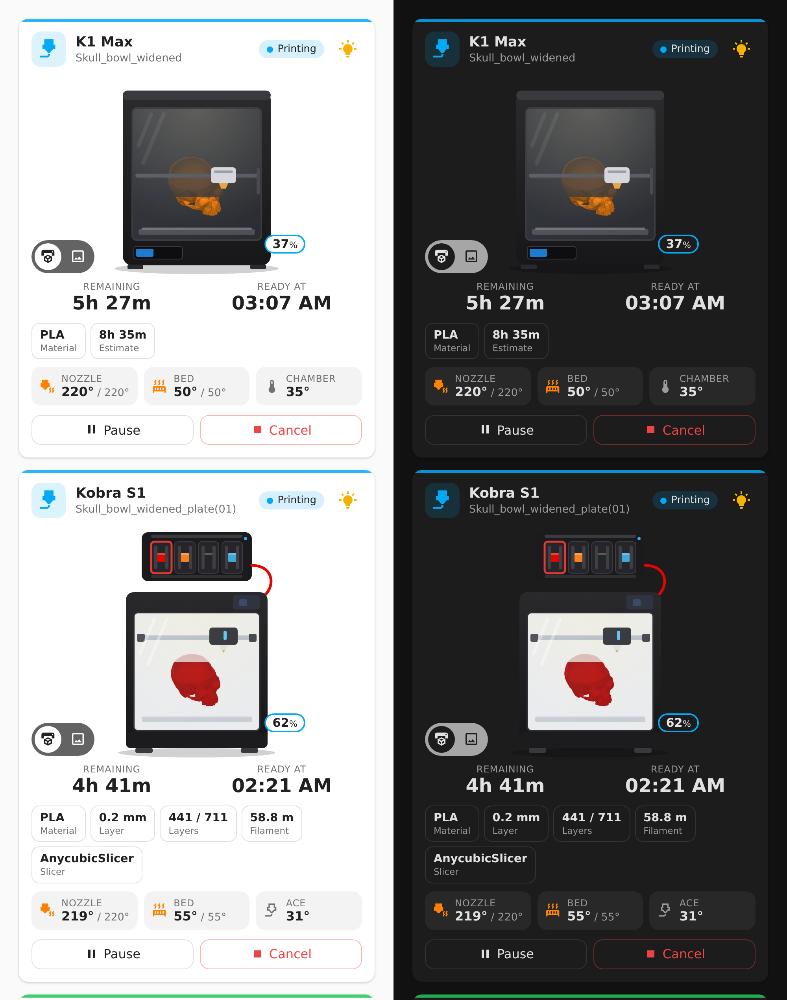

# Creality Cloud for Home Assistant

[](https://hacs.xyz/)
[](https://github.com/Rein033/ha-creality-cloud/actions/workflows/validate.yml)
[](https://github.com/Rein033/ha-creality-cloud/releases)

Monitor and control **Creality 3D printers** (K1, K1 Max, K1C and other printers that show up in the Creality Cloud app)
from Home Assistant, through **Creality Cloud**. Comes with its own dashboard card.

Made for printers that Home Assistant **cannot reach on the local network**, for example a printer at a friend's or
partner's house, at work, or on a separate network. No port forwarding, VPN or rooting needed.



> [!IMPORTANT]
> **Unofficial.** Creality does not publish an API for this. This integration uses the same endpoints as the Creality
> Cloud website, which can change without notice. Only the international region (crealitycloud.com) is supported.
> Not affiliated with Creality.

> [!TIP]
> Is the printer on the **same network** as Home Assistant? Then a local integration such as
> [ha_creality_ws](https://github.com/3dg1luk43/ha_creality_ws) is faster and also gives you the camera and fans.

## Features

One device per printer on your account, updated every 30 seconds.

| Platform | Entities |
|---|---|
| Sensor | Status (idle, printing, paused, finished, failed, stopped), progress, time remaining, print started, print ends, job name, nozzle / bed / chamber temperature, nozzle and bed target, error code |
| Binary sensor | Online, printing |
| Button | Pause, resume, cancel print (only available when that makes sense) |
| Light | Printer LED |
| Image | Preview of the current print |

- **Safe by design:** only these fixed commands can be sent. No G-code, no file upload.
- **Reauth:** when Creality stops accepting your password, Home Assistant asks you to log in again.
- **Diagnostics** for bug reports, with e-mail, password, token, serial numbers and network details removed.
- **Languages:** English and Dutch.

## Installation

### HACS (recommended)

[](https://my.home-assistant.io/redirect/hacs_repository/?owner=Rein033&repository=ha-creality-cloud&category=integration)

Or by hand:

1. HACS → ⋮ (top right) → **Custom repositories**.
2. Repository `https://github.com/Rein033/ha-creality-cloud`, type **Integration** → **Add**.
3. Search for **Creality Cloud** in HACS, **Download**, and restart Home Assistant.

### Manual

Copy `custom_components/creality_cloud` into the `custom_components` folder of your Home Assistant configuration and
restart Home Assistant.

## Setup

[](https://my.home-assistant.io/redirect/config_flow_start/?domain=creality_cloud)

1. Make sure the printer is added to your account in the **Creality Cloud app**.
2. Settings → Devices & services → **Add integration** → **Creality Cloud**.
3. Log in with the e-mail address and password of your Creality Cloud account.

Every printer on the account becomes a device. The password is stored in the Home Assistant config entry, like other
cloud integrations do.

## The card

The integration serves its own card and loads it on every dashboard. You don't need to install anything else.
Add it from the card picker (search for **Creality Print Card**) and set it up in the visual editor, or use YAML:

```yaml
type: custom:creality-print-card
entity: sensor.k1_max_status   # any entity of the printer
name: K1 Max                   # optional, defaults to the device name
view: printer                  # printer (drawing) or preview (progress ring)
show_slicer: true
show_temperatures: true
show_controls: true            # pause / resume / cancel and the light
show_view_switch: true
```

| Option | Default | Description |
|---|---|---|
| `entity` | – | Any entity of the printer. The card finds the other entities through the device. |
| `name` | device name | Title on the card. |
| `view` | `printer` | Start view: the drawn printer with the print growing inside it, or the progress ring with the preview. |
| `show_slicer` | `true` | Material, layer height, layers, filament used, slicer estimate and slicer. |
| `show_temperatures` | `true` | Nozzle, bed and chamber (or ACE) temperature, with the target while heating. |
| `show_controls` | `true` | Pause / resume / cancel while printing, and the light button. |
| `show_view_switch` | `true` | The printer / preview switch on the card. |

The printer drawings are original artwork. Tap a value to open its history. The card follows your theme and language,
and renaming entities does not break it.

**Anycubic printers too:** the card also works with printers of the
[Anycubic Cloud integration](https://github.com/WaresWichall/hass-anycubic_cloud) (and its forks): it then shows a Kobra
with the ACE Pro, its spool colours, layers and filament used.

## Automation examples

Notify when a print is done:

```yaml
triggers:
  - trigger: state
    entity_id: sensor.k1_max_status
    to: finished
actions:
  - action: notify.mobile_app_your_phone
    data:
      title: Print finished
      message: "The print on the K1 Max is done."
```

Notify when the printer goes offline during a print:

```yaml
triggers:
  - trigger: state
    entity_id: binary_sensor.k1_max_online
    to: "off"
    for: "00:05:00"
conditions:
  - condition: state
    entity_id: binary_sensor.k1_max_printing
    state: "on"
actions:
  - action: notify.mobile_app_your_phone
    data:
      message: The 3D printer lost its connection to Creality Cloud.
```

Entity IDs depend on your printer's name and language; check them on the device page.

## FAQ

**Is there a camera?**
No. Creality Cloud only streams the camera to its own app, through an encrypted video connection.

**Progress stays at 0% for a while.**
Creality Cloud updates progress less often than the printer itself. It catches up during the print.

**Which printers work?**
Tested with a K1 Max (firmware 1.3.5.22). Other printers that show live data in the Creality Cloud app should work.
Please open an issue with diagnostics if yours does not.

**China region (crealitycloud.cn)?**
Not supported yet.

**How often does it poll?**
Every 30 seconds, plus right after you press a button or toggle the light.

## How it works

| What | Request |
|---|---|
| Log in | `POST https://id.creality.com/api/cxy/account/v2/loginV2` |
| Printers and live state | `POST https://api.crealitycloud.com/api/rest/print/cluster/devices/getDeviceList` |
| Command | `POST https://api.crealitycloud.com/api/rest/iotrouter/rpc/twoway/<tbId>` with `{method: "set", params: {...}}` |

Commands are the same messages as the printer's local websocket: `pause`, `stop`, `lightSw`.

## Contributing

See [CONTRIBUTING.md](CONTRIBUTING.md) and the [changelog](CHANGELOG.md).

## License

[MIT](LICENSE). Creality and Creality Cloud are trademarks of their owner; this project is not affiliated with or
endorsed by Creality.
